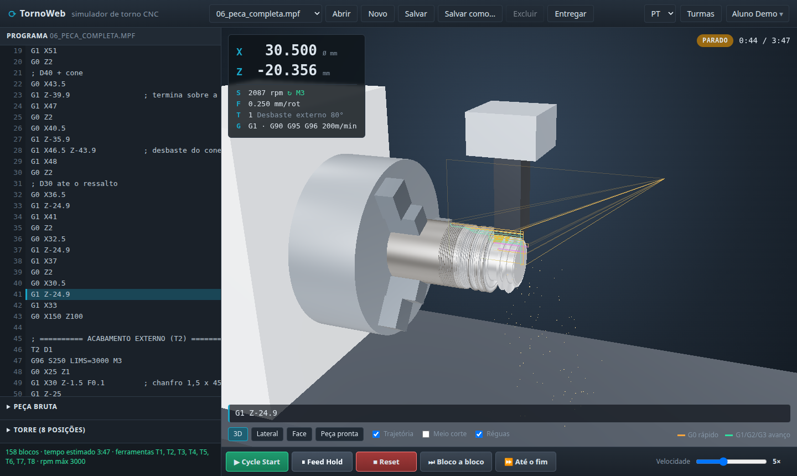
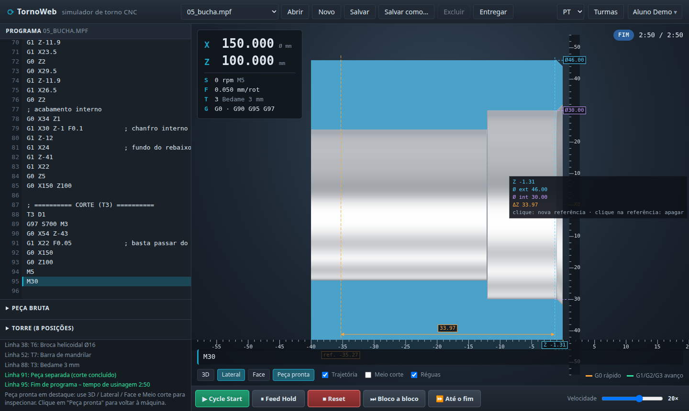
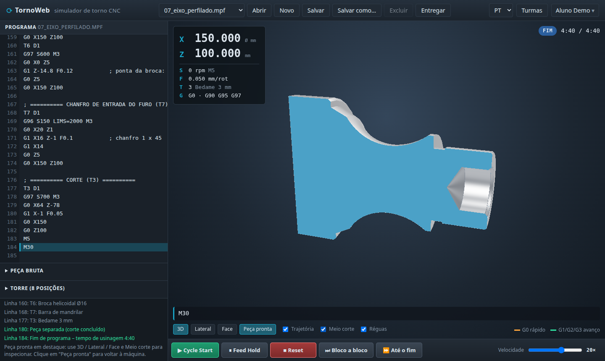
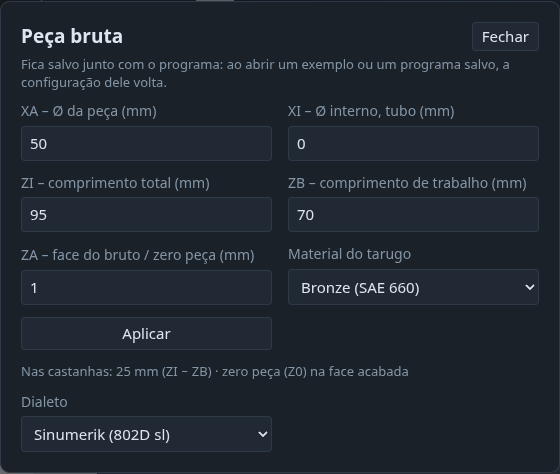
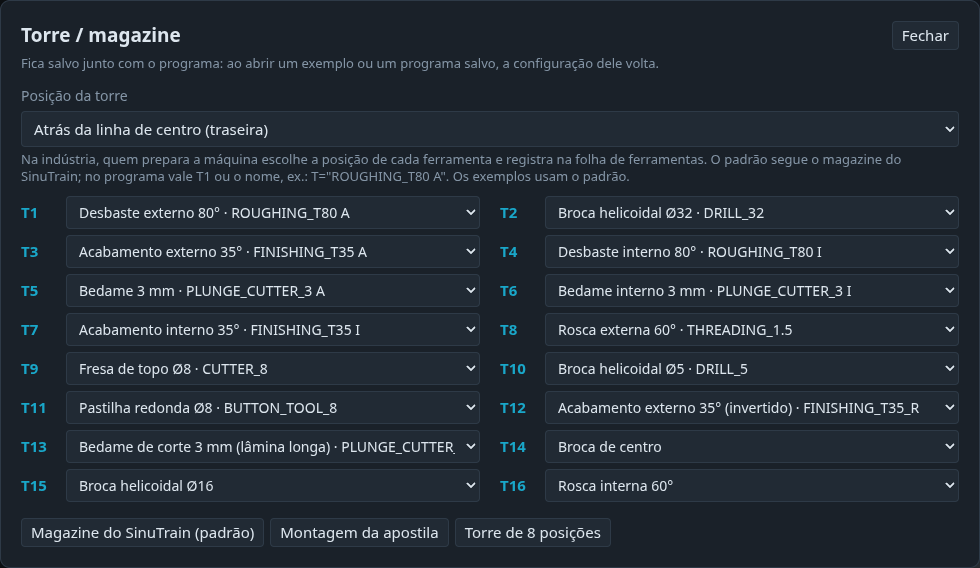

# TornoWeb

Simulador de torno CNC no navegador, inspirado no SinuTrain: você escreve
G-code, aperta **Cycle Start** e vê a ferramenta usinando a peça em 3D (Three.js/WebGL).



| Vista Lateral com réguas | Peça pronta em meio corte |
|---|---|
|  |  |
| Passe o mouse para ler Z, Ø externo e Ø interno; clique para medir comprimentos. | Ao separar a peça no corte, ela aparece sozinha em destaque. |

**Peça bruta e torre configuráveis, salvas com o programa:** os mesmos campos do SinuTrain (XA, XI,
ZI, ZB, ZA), com bitolas em polegadas, e o material do tarugo; magazine do SinuTrain como padrão,
montagem da apostila ou torre de 8 posições; posição da torre (atrás, em cima ou na frente). Cada
programa e cada exemplo guarda a sua configuração. O programa também pode definir a peça com
`WORKPIECE(...)`, como no SinuTrain.

|  |  |
|---|---|

## Como rodar

```bash
npm install
npm start          # http://localhost:3000 – crie sua conta em "Criar conta"
npm test           # testes unitários e da API (rápidos, sem navegador)
```

Requer Node.js 22.13 ou mais novo (usa o SQLite nativo do Node). O banco fica em `data/cnc.db`
(mude com `DB_PATH`).

### Contas e turmas

- Qualquer pessoa cria a própria conta (nome, usuário, senha e e-mail opcional).
- Não existe tipo fixo de conta: quem cria uma turma é o professor dela. A mesma pessoa pode ser
  professora de uma turma e aluna de outra.
- O professor convida pelo **link/código** da turma (pode gerar um novo código, o que invalida o antigo).
- O aluno **entrega** um programa na turma; fica guardada uma cópia de como estava no momento.
  O professor vê só as entregas, não os demais programas do aluno.
- Administração do sistema (desativar contas abusivas): usuários listados em `ADMIN_USERNAMES`.

### Variáveis de ambiente

| Variável | Uso |
|---|---|
| `PORT` | Porta HTTP (padrão 3000) |
| `DB_PATH` | Arquivo do banco SQLite (padrão `data/cnc.db`) |
| `NODE_ENV=production` | Cookie de sessão só por HTTPS (`Secure`) |
| `TRUST_PROXY` | Atrás de proxy reverso (nginx/Caddy): ex. `1` ou `loopback` |
| `ADMIN_USERNAMES` | Usuários administradores do sistema, separados por vírgula |

## Testes

| Comando | O que roda |
|---|---|
| `npm test` | Unitários (`test/unit`) e API (`test/api`), ~3 s |
| `npm run test:coverage` | O mesmo, com relatório de cobertura de `shared/` e `server/` |
| `npm run test:e2e` | Navegador real com Playwright (`test/e2e`), ~3 min. Na 1ª vez: `npx playwright install chromium` |
| `npm run test:all` | Tudo |

- **Unitários:** interpretador de G-code, ferramentas, remoção de material (`shared/stock-model.js`),
  motor da simulação (`shared/simulator.js`) e traduções (toda mensagem tem texto em PT e EN).
- **Exemplos:** `test/unit/examples.test.js` simula cada programa de `programs/` até o fim, sem navegador,
  e confere as **cotas da peça pronta**. Ao criar ou alterar um exemplo, acrescente as cotas lá
  (o teste avisa se algum exemplo ficou sem cotas).
- **API:** contas, sessões, programas, turmas, entregas, administração e proteções (CSRF, limites).
- **Ponta a ponta:** login e cadastro, simulação com alarme, Cycle Start/Feed Hold/bloco a bloco,
  salvar/abrir/excluir, idioma, torre, turmas com convite e entrega, administração. O servidor sobe
  com banco em memória.
- **CI:** `.github/workflows/test.yml` roda tudo a cada push (quando o repositório estiver no GitHub).

## Arquitetura

Cliente-servidor: o navegador faz o trabalho pesado (interpretar G-code, simular, desenhar em 3D);
o servidor cuida de login, sessões, banco de dados e programas dos alunos.

| Parte | Arquivo | Função |
|---|---|---|
| Entrada | `server.js` | Abre o banco e sobe o servidor |
| Servidor | `server/app.js`, `server/routes/*` | Express: API e arquivos estáticos |
| Banco | `server/db.js` | SQLite + migrações (usuários, sessões, programas, configurações) |
| Autenticação | `server/auth.js` | Senhas (scrypt), sessões por cookie, limite de tentativas |
| Interpretador | `shared/gcode.js` | G-code → eventos temporizados (roda no navegador e no Node) |
| Modelo da peça | `shared/stock-model.js` | Perfis externo/interno, remoção de material e colisões (sem 3D) |
| Motor da simulação | `shared/simulator.js` | Executa os eventos no tempo sobre o modelo da peça (sem interface) |
| Ferramentas | `shared/tools.js` | Magazine (SinuTrain), montagens prontas e geometria das pastilhas |
| Ciclos | `shared/cycles.js`, `shared/geometry.js` | CYCLE93/95/97, contorno com rótulos, chanfros e raios de canto |
| Aparência | `shared/appearance.js` | Materiais do tarugo e posições da torre (só estética) |
| Idiomas | `shared/i18n.js` | Textos PT/EN da interface e das mensagens |
| Medição | `shared/measure.js` | Faces do perfil e passo das réguas (testado no Node) |
| Réguas | `public/js/rulers.js` | Réguas graduadas e leitura de medidas na vista Lateral |
| Peça 3D | `public/js/stock.js` | Malha de revolução e vista em corte a partir do modelo da peça |
| Cena 3D | `public/js/scene.js` | Placa, ferramenta, trajetória, cavacos, vista em corte |
| Simulador | `public/js/main.js` | Editor, DRO, softkeys, programas; liga o motor à cena 3D |
| Turmas | `public/turmas.html`, `public/join.html` | Criar turmas, convites, alunos e entregas |
| Contas | `public/login.html`, `public/signup.html` | Entrar e criar conta |
| Administração | `public/admin.html` | Ativar/desativar contas (só `ADMIN_USERNAMES`) |

API (todas exigem login, exceto cadastro e login; alterações só com JSON da mesma origem):
- `POST /api/auth/signup`, `POST /api/auth/login`, `POST /api/auth/logout`, `GET /api/auth/me`, `POST /api/auth/password`
- `GET|PUT /api/settings`
- `GET /api/programs` (exemplos + meus), `GET /api/programs/examples/:nome`,
  `GET|PUT|DELETE /api/programs/:id`, `POST /api/programs`
- Turmas: `GET|POST /api/turmas`, `GET|PATCH|DELETE /api/turmas/:id`, `POST /api/turmas/:id/invite`,
  `GET /api/turmas/invite/:codigo`, `POST /api/turmas/join`, `DELETE /api/turmas/:id/members/:userId`,
  `POST /api/turmas/:id/submissions`, `GET /api/turmas/:id/submissions/:sid`
- Administração: `GET /api/admin/users`, `PATCH /api/admin/users/:id`
- `POST /api/parse` (apoio; o cliente interpreta localmente)

## G-code suportado

- Movimento: `G0`, `G1`, `G2`/`G3` (com `I`/`K` ou `CR=`/`R`), `G33`/`G32` (rosca como avanço reto)
- Modos: `G90`/`G91`, `G94`/`G95` (e `G98`/`G99` Fanuc), `G96`/`G97`, `LIMS=`, `G50 S`, `DIAMON`/`DIAMOF`
- Fanuc: `U`/`W` incrementais, `T0101`, `G28 U0 W0`, `O`, `%`, comentários `( )`
- Sinumerik: `T1 D1`, comentários `;`, `G4 F` (espera), `G71` (mm), `G54`
- Peça bruta do SINUMERIK Operate (SinuTrain): `WORKPIECE(,,,"CYLINDER",0,2,120,100,82.55)` e `"PIPE"`
  (tubo) — lida ao abrir o programa e no Cycle Start
- Corretor `D`: no bedame do magazine do SinuTrain, `D1` = canto direito e `D2` = canto esquerdo (como no SinuTrain); no bedame da máquina da escola (torres da apostila e de 8 posições), `D1` = canto esquerdo
- `M3`/`M4`/`M5`, `M0`/`M1` (parada), `M2`/`M30`, `M8`/`M9`
- Convenções: X em diâmetro, Z=0 na face, G2 = horário com X para cima.

Alarmes simulados: G0 dentro do material, ferramenta na peça com fuso parado,
colisão com a placa, F ausente, arco inválido, ferramenta inexistente, erro de sintaxe.

Avisos didáticos (não param o programa): avanço fora da faixa usual da ferramenta (ex.: `F0.02` no
desbaste), broca andando em avanço fora do centro, e `CHF=`/`CHR=`/`RND=` ainda não executados fora do
contorno de ciclo. `ANG=` numa reta com um só eixo (ex.: `X78 ANG=225`) já é executado: o comando calcula o outro.

Torre/magazine **configurável** (painel "Torre" no simulador, 16 posições): cada posição recebe uma
ferramenta do catálogo ou fica vazia. O padrão (usado nos exemplos) é o **magazine do SinuTrain**:
T1 ROUGHING_T80 A, T2 DRILL_32, T3 FINISHING_T35 A, T4 ROUGHING_T80 I, T5 PLUNGE_CUTTER_3 A,
T6 PLUNGE_CUTTER_3 I, T7 FINISHING_T35 I, T8 THREADING_1.5, T9 CUTTER_8, T10 DRILL_5,
T11 BUTTON_TOOL_8, T12 FINISHING_T35_R, T13 PLUNGE_CUTTER_3P, mais T14 broca de centro, T15 broca Ø16
e T16 rosca interna. O programa aceita o número ou o nome: `T="ROUGHING_T80 A"`. Montagens prontas:
**apostila** (T1 desbaste, T2 bedame, T6 rosca externa, T8 acabamento) e a **torre de 8 posições** antiga.

A torre pode ficar **atrás da linha de centro** (padrão, como na máquina da escola), em cima ou na
frente; as vistas 2D mostram sempre X+ para cima. O **material do tarugo** (aço, inox, alumínio,
latão, cobre, bronze, ferro fundido, nylon, POM, PTFE) muda só as cores.

Ciclos do 802D sl: **CYCLE95** (desbaste/acabamento de contorno, com o contorno entre rótulos
`"INICIO:FIM"` no próprio programa ou num programa salvo, ex. `"CONT1"`), **CYCLE93** (canal) e
**CYCLE97** (rosca, com a hélice desenhada na peça). Também `GOTOF`/`GOTOB` com rótulos e, dentro do
contorno, `CHR=`/`CHF=`/`RND=` e `ANG=`. Exemplo completo em `programs/08_ciclos_sinumerik.mpf`.

O Ø externo da peça bruta sugere as bitolas em polegadas (1", 1 1/8", 2", 3 1/4", 3 5/8"…).

Usinagem externa, furação (só em X0) e usinagem interna removem material; alarmes de colisão também
para broca fora do centro e corpo da barra de mandrilar batendo no material.

Exemplos em `programs/`: 01 básico, 02 eixo escalonado, 03 ponta esférica (Fanuc), 04 pino roscado M20,
05 bucha (furação e mandrilamento), 06 peça completa, 07 eixo perfilado (gola côncava). Com ciclos:
08 eixo com CYCLE95/93/97, 09 bucha com CYCLE95 interno e rosca interna, 10 flange com CYCLE95 de
faceamento, 11 três tipos de canal (CYCLE93), 12 rebaixo no contorno e rosca de 2 entradas, 13 eixo com
cone de 25°, raios e chanfros (gabarito de avaliação revisado: CYCLE95 e chanfro de trás com `ANG=`).

**Configuração salva com o programa:** a peça bruta, o material e as ferramentas da torre ficam
salvos junto com cada programa (e com a entrega na turma). Cada exemplo traz a sua no cabeçalho
(`; Bruto: D50 x 80 mm, face em Z1`, `; Material: aluminum`, `; Torre: sinutrain|apostila|torre8`),
então abrir um exemplo sempre arruma a torre que o código espera. Mudar a torre ou o bruto marca o
programa como modificado. A peça bruta e a torre ficam em janelas abertas pelos botões do painel.

### Desempenho e placa de vídeo

No canto superior direito da vista há uma etiqueta: **verde = placa de vídeo**, **laranja = Software (CPU)**,
com o nome do dispositivo e os quadros desenhados por segundo (0 = parado, sem gastar CPU).
Se aparecer "Software (CPU)", ligue a aceleração gráfica do navegador (Chrome/Edge: Configurações →
Sistema → "Usar aceleração gráfica quando disponível") e reinicie-o; se continuar, atualize o driver de vídeo.

### Vistas (inspiradas no SINUMERIK Operate)

| Botão | O que mostra |
|---|---|
| **3D** | Vista em perspectiva; arraste para girar, roda do mouse para aproximar |
| **Lateral** | Vista 2D em corte (perfil da peça, com furos), como a "Side view" / "Half cut view" |
| **Face** | Olhando a peça pelo eixo, como a "Face view" |
| **Meio corte** | Corta a peça ao meio no 3D para ver o interior |
| **Peça pronta** | Só a peça fabricada, sem máquina; abre sozinha quando a peça é separada no corte |

**Réguas** (vista Lateral, opção "Réguas"): régua Z embaixo da peça e régua X em diâmetro ao lado da
face. Passe o mouse sobre a peça para ler Z, Ø externo e Ø interno (a leitura gruda nas faces);
clique para fixar uma referência e medir a distância até outro ponto (ΔZ).

### Peça bruta

Em "Peça bruta", os mesmos campos do SinuTrain:

| Campo | Significado |
|---|---|
| **XA** | Ø da peça |
| **XI** | Ø interno do tubo (0 = barra maciça) |
| **ZI** | Comprimento total do bruto |
| **ZB** | Comprimento de trabalho (fora das castanhas); passar dele é colisão com a placa |
| **ZA** | Face do bruto; o zero peça (Z0) é a face acabada (ZA = 2 deixa 2 mm para facear) |

O trecho preso na placa é ZI − ZB.

O programa também ajusta a peça bruta: com `WORKPIECE(,,,"CYLINDER",0,ZA,ZI,ZB,XA)` (ou `"PIPE"` com XI),
como no SinuTrain, ou com um comentário cujo segundo número é o comprimento de trabalho (ZB):

```
; Bruto: D50 x 80 mm, face em Z1
; Bruto: D50 x 60 mm, tubo Ø20, castanhas 30, face em Z1
```

## Limitações e próximos passos

- Limitações conhecidas (com caminho sugerido para cada uma): [docs/LIMITACOES.md](docs/LIMITACOES.md)
- Plano, decisões e perguntas em aberto: [docs/PLANO.md](docs/PLANO.md)

## Licença

[MIT](LICENSE): pode usar, copiar, modificar e distribuir para qualquer fim, inclusive comercial,
desde que mantenha o aviso de copyright e o texto da licença. Sem garantias.
